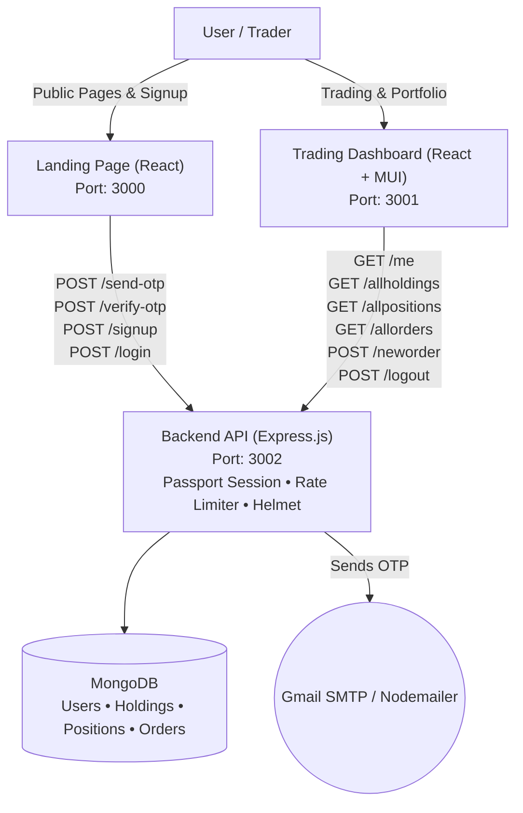

# 📈 ProfitProfile: Trading & Brokerage Web Application

**An educational brokerage web application prototype demonstrating user authentication, portfolio visualization with mock market data, and order persistence to MongoDB.**

[](https://reactjs.org/)
[](https://expressjs.com/)
[](https://www.mongodb.com/)
[](#test-coverage)
[](#license)

---

## Credits

- **Original Project:** Developed by [Satyam Pandey](https://github.com/).
- **Maintenance & Hardening:** Maintained and enhanced by **Rohit Kumar**.

### What I Changed:
- **Dashboard & Frontend Bug Fixes:**
  - Resolved `BuyActionWindow` React Context crash (`TypeError: GeneralContext.closeBuyWindow is not a function`).
  - Standardized API endpoints to use `REACT_APP_API_URL` instead of hardcoded `localhost` strings.
  - Aligned dashboard routes (`/holdings`, `/positions`, `/orders`) and `/neworder` casing between client and server.
  - Connected `Orders.js` to fetch and render live persisted trades from the backend.
  - Fixed React Router DOM version incompatibility on frontend (`react-router-dom@6.22.2`).
- **Security Hardening:**
  - Enforced fail-fast server startup: backend exits immediately with status 1 if `SESSION_SECRET` is unset.
  - Configured `express-session` with `httpOnly: true`, `sameSite: "lax"`, and conditional `secure` in production.
  - Replaced wildcard CORS with strict origin allowlist (`http://localhost:3000`, `http://localhost:3001` or `CORS_ORIGINS`) with `credentials: true`.
  - Added HTTP security headers with `helmet`.
  - Implemented rate limiting on auth and OTP routes, 60-second cooldown per email, and a 5-attempt brute-force lockout on OTP verification with periodic store cleanup.
  - Added schema validation on order payloads (`qty > 0`, `price > 0`, mode `BUY`/`SELL`).
  - Implemented a centralized error handler returning clean JSON responses without leaking internal stack traces.
  - Removed `console.log` noise and uninstalled dead dependency `"module-name"`.
- **User Authentication & Data Scoping:**
  - Added full session-based authentication (`POST /signup`, `POST /login`, `POST /logout`, `GET /me`) using `passport-local` and `passport-local-mongoose`.
  - Protected all portfolio and order routes with `requireAuth` middleware (returning `401 Unauthorized` for unauthenticated requests).
  - Added a `user` reference (`ObjectId`) to `Holdings`, `Positions`, and `Orders` schemas; all queries filter strictly by `req.user._id` for tenant data isolation.
  - Auto-seeded new user accounts on signup with mock holdings and positions so accounts start with sample data.
  - Connected landing page login and signup forms to backend auth, with redirect to dashboard on login and redirect to `/login` when unauthenticated.
- **Configuration & Monorepo Cleanup:**
  - Standardized application ports across root scripts, client configurations, and CORS defaults:
    - Frontend (Landing Page): `3000`
    - Dashboard: `3001`
    - Backend API: `3002`
  - Cleaned root `package.json`: removed unrelated `session` package, misplaced `passport`, and `@types/passport-local`.
  - Unified root `.env.example` and `backend/.env.example` with identical configuration variables.
  - Enabled clean-clone workflows with `npm run install:all`, `npm run start:all`, and `npm run test:all`.
- **Testing & Continuous Integration:**
  - Built an automated integration test suite in Jest and Supertest with `mongodb-memory-server` covering 19 test cases.
  - Replaced Create React App starter tests with meaningful component render tests for frontend and dashboard.
  - Created `.github/workflows/ci.yml` multi-job CI workflow running test and build across all three applications.

---

## Table of Contents

- [Overview](#overview)
- [Architecture](#architecture)
- [System Components](#system-components)
- [API Reference](#api-reference)
- [Test Coverage](#test-coverage)
- [Environment Variables](#environment-variables)
- [Running Locally](#running-locally)
- [Roadmap (Planned, Not Implemented)](#roadmap-planned-not-implemented)
- [Screenshots](#screenshots)
- [License](#license)

---

## Overview

ProfitProfile is a full-stack educational trading platform prototype. It allows users to register via email OTP verification, log into an authenticated dashboard, view mock portfolio holdings and positions, and place buy/sell orders that persist in a MongoDB database scoped to each user.

> **Note on Market Data:** Stock prices, holdings, and position movements in this project are static mock data for educational and portfolio demonstration. Orders placed by the user are validated and stored in MongoDB.

---

## Architecture



---

## System Components

| Component | Port | Description | Tech Stack | Directory |
|---|---|---|---|---|
| **Frontend** | `3000` | Public landing page, product overviews, pricing, and signup/login flows | React 18, React Router 6, Bootstrap | `/frontend` |
| **Dashboard** | `3001` | Authenticated client interface: watchlists, portfolio tables, order placement, charts | React 18, MUI, Chart.js, React Router 6 | `/dashboard` |
| **Backend API** | `3002` | RESTful API service: session auth, rate limiting, OTP email delivery, and user-scoped data | Node.js, Express 5, Mongoose, Passport | `/backend` |

---

## API Reference

All protected endpoints require an active session cookie (`connect.sid`) and return `401 Unauthorized` if unauthenticated.

| Method | Path | Auth Required | Description |
|---|---|---|---|
| `POST` | `/send-otp` | No (Rate Limited) | Sends 6-digit OTP to user's email (60s cooldown per email, 5 requests/hr IP limit) |
| `POST` | `/verify-otp` | No (Rate Limited) | Verifies submitted OTP against in-memory store (5 attempts max before lockout) |
| `POST` | `/signup` | No | Creates new user account after OTP verification, starts session, seeds mock portfolio |
| `POST` | `/login` | No (Rate Limited) | Authenticates credentials with local strategy, starts session |
| `POST` | `/logout` | Yes | Destroys session and clears cookie |
| `GET` | `/me` | Yes | Returns `{ authenticated: true, user: { id, email } }` |
| `GET` | `/allholdings` | Yes | Retrieves holdings scoped to `req.user._id` |
| `GET` | `/allpositions`| Yes | Retrieves active positions scoped to `req.user._id` |
| `GET` | `/allorders` | Yes | Retrieves executed orders scoped to `req.user._id` (sorted newest first) |
| `POST` | `/neworder` | Yes | Validates payload (`qty > 0`, `price > 0`, `mode: BUY|SELL`) and saves order for user |

---

## Test Coverage

Backend test suite runs on **Jest**, **Supertest**, and **`mongodb-memory-server`** (no running external database required).

Measured coverage (`npm run test:coverage` in `/backend`):

| Metric | Measured Value | Scope |
|---|---|---|
| **Lines** | **82.50%** | Backend `index.js`, models, schemas |
| **Statements** | **80.97%** | Entire backend codebase |
| **Branches** | **70.58%** | Conditional validation & auth logic |
| **Functions** | **70.00%** | Route handlers, middleware, utilities |
| **Schemas & Models**| **100.00%** | `holdings.js`, `orders.js`, `positions.js`, `users.js` |

Frontend and Dashboard render tests run via React Testing Library with 100% pass rate.

---

## Environment Variables

Both the root `.env.example` and `backend/.env.example` templates contain:

```env
# Server Port (Backend runs on 3002)
PORT=3002

# Session Secret (Required; backend will fail-fast if unset)
SESSION_SECRET=replace_with_a_secure_random_session_secret_min_32_chars

# Allowed CORS Origins (comma-separated, frontend on 3000, dashboard on 3001)
CORS_ORIGINS=http://localhost:3000,http://localhost:3001

# MongoDB Connection URI
MONGO_URL=mongodb+srv://<username>:<password>@cluster.mongodb.net/<database>?retryWrites=true&w=majority

# Nodemailer / Gmail SMTP Configuration
# Note: EMAIL_PASS requires a 16-character Google App Password (not your account password)
EMAIL_USER=your_email@example.com
EMAIL_PASS=your_16_char_gmail_app_password
```

> [!IMPORTANT]
> **Gmail SMTP Note:** Google accounts with 2-Step Verification require an **App Password** (16 characters generated at `myaccount.google.com/apppasswords`), not the personal Google account password.

---

## Running Locally

### Prerequisites
- Node.js (v18+ or v20 LTS recommended)
- MongoDB instance (local or MongoDB Atlas connection URI)

### 1. Installation
Clone the repository and install all dependencies:
```bash
git clone https://github.com/Rohit-hub-coder/profit-profile.git
cd profit-profile
npm run install:all
```

### 2. Configure Environment
Copy `.env.example` to `backend/.env` and update credentials:
```bash
cp .env.example backend/.env
```
Ensure `SESSION_SECRET` is set to a secure string.

### 3. Run the Monorepo
Start all three applications concurrently:
```bash
npm run start:all
```

Or run each service individually:
```bash
# Terminal 1: Backend API (Port 3002)
npm run start:backend

# Terminal 2: Landing Frontend (Port 3000)
npm run start:frontend

# Terminal 3: Trading Dashboard (Port 3001)
npm run start:dashboard
```

### 4. Run the Test Suites
```bash
# Run all test suites across the monorepo:
npm run test:all

# Run backend tests with coverage report:
cd backend && npm run test:coverage
```

---

## Roadmap (Planned, Not Implemented)

The following capabilities are prospective architectural enhancements and are not yet implemented in the current codebase:
- [ ] LSTM-based deep learning price prediction service.
- [ ] WebSocket-based live streaming ticker integration (replacing static mock market data).
- [ ] OAuth 2.0 social login (Google / GitHub).
- [ ] Redis-backed distributed session and rate-limit store.
- [ ] Real-time order book matching engine.

---

## Screenshots

Screenshots of the user interface are documented in the [docs/screenshots](docs/screenshots/README.md) directory:
- Landing Page (`http://localhost:3000/`)
- OTP Signup & Verification (`http://localhost:3000/sighnup`)
- Login Screen (`http://localhost:3000/login`)
- Dashboard Summary (`http://localhost:3001/`)
- Holdings Portfolio & Asset Charts (`http://localhost:3001/holdings`)
- Active Positions (`http://localhost:3001/positions`)
- Order Book (`http://localhost:3001/orders`)
- Buy / Sell Action Dialog

---

## License

This project is licensed under the MIT License — see the [LICENSE](LICENSE) file for details.
