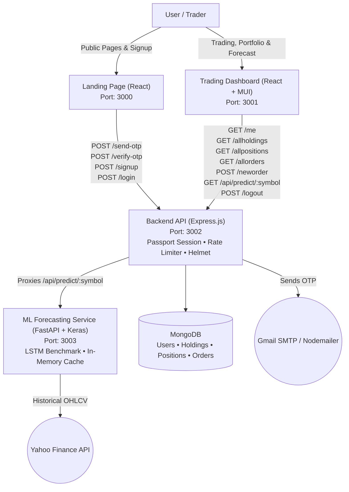

# 📈 ProfitProfile: Trading & Brokerage Web Application

**An educational brokerage web application prototype demonstrating user authentication, portfolio visualization with mock market data, an AI forecasting benchmark module, and order persistence to MongoDB.**

[](https://reactjs.org/)
[](https://expressjs.com/)
[](https://fastapi.tiangolo.com/)
[](https://www.mongodb.com/)
[](#test-coverage)
[](#license)

---

## Credits

- **Original Project:** Developed by [Satyam Pandey](https://github.com/).
- **Maintenance, Hardening & ML Module:** Maintained, hardened, and expanded by **Rohit Kumar**.

### What I Changed:
- **Machine Learning & Time Series Forecasting (New Module):**
  - Designed and built a standalone, reproducible educational stock forecasting module benchmarking a dual-output LSTM network against 4 classical baselines across 12 liquid National Stock Exchange (NSE) tickers over 10.8 years (2,670 trading days per symbol).
  - Enforced strict zero-lookahead protocols: shift perturbation tests verifying zero leakage from $t+1$ to $t$, chronological 70/15/15 splitting, and `StandardScaler` fitted strictly on training partitions.
  - Published completely honest benchmark metrics from `metrics.json`: the LSTM achieves 47.49% directional accuracy on unseen test data, failing to outperform naive baselines (persistence 49.32%, majority class 47.56%), with zero-return achieving lower RMSE (0.014428 vs 0.015254).
  - Documented pre-registered LSTM collapse: the model predicted 'UP' for 99.57% of test samples (4,409 / 4,428), behaving identically to the majority-class baseline.
  - Investigated and resolved Ridge regression numerical instability: resolved a zero-volume denominator spike in `volume_change` (restoring Ridge RMSE from 0.064987 down to 0.014619, matching zero-return baseline of 0.014428).
  - Explicitly categorized non-forecast portfolio instruments (SGBMAY29, KPITTECH, QUICKHEAL, EVEREADY, JUBLFOOD) with dedicated informative guidance in the Forecast UI.
  - Deployed an asynchronous FastAPI microservice on port 3003 with 15-minute in-memory caching to optimize upstream Yahoo Finance queries.
  - Connected the Node.js backend proxy (`GET /api/predict/:symbol`) with session authentication, allowlist validation, and 503 fallback handling.
  - Created a dedicated "Forecast" panel on the React dashboard featuring Chart.js historical trend lines, next-day price projection, and educational disclaimer banners.
- **Dashboard & Frontend Bug Fixes:**
  - Resolved `BuyActionWindow` React Context crash (`TypeError: GeneralContext.closeBuyWindow is not a function`).
  - Standardized API endpoints to use `REACT_APP_API_URL` instead of hardcoded `localhost` strings.
  - Aligned dashboard routes (`/holdings`, `/positions`, `/orders`, `/forecast`) and `/neworder` casing between client and server.
  - Connected `Orders.js` to fetch and render live persisted trades from the backend.
  - Fixed React Router DOM version incompatibility on frontend (`react-router-dom@6.22.2`).
- **Security Hardening:**
  - Enforced fail-fast server startup: backend exits immediately with status 1 if `SESSION_SECRET` is unset.
  - Configured `express-session` with `httpOnly: true`, `sameSite: "lax"`, and conditional `secure` in production.
  - Replaced wildcard CORS with strict origin allowlist (`http://localhost:3000`, `http://localhost:3001` or `CORS_ORIGINS`) with `credentials: true`.
  - Added HTTP security headers with `helmet`.
  - Implemented rate limiting on auth and OTP routes, 60-second cooldown per email, and a 5-attempt brute-force lockout on OTP verification with periodic store cleanup.
  - Added schema validation on order payloads (`qty > 0`, `price > 0`, mode `BUY`/`SELL`).
  - Implemented a centralized error handler returning clean JSON responses without leaking internal stack traces.
  - Removed `console.log` noise and uninstalled dead dependency `"module-name"`.
- **User Authentication & Data Scoping:**
  - Added full session-based authentication (`POST /signup`, `POST /login`, `POST /logout`, `GET /me`) using `passport-local` and `passport-local-mongoose`.
  - Protected all portfolio, order, and forecast routes with `requireAuth` middleware (returning `401 Unauthorized` for unauthenticated requests).
  - Added a `user` reference (`ObjectId`) to `Holdings`, `Positions`, and `Orders` schemas; all queries filter strictly by `req.user._id` for tenant data isolation.
  - Auto-seeded new user accounts on signup with mock holdings and positions so accounts start with sample data.
  - Connected landing page login and signup forms to backend auth, with redirect to dashboard on login and redirect to `/login` when unauthenticated.
- **Configuration & Monorepo Cleanup:**
  - Standardized application ports across root scripts, client configurations, and CORS defaults:
    - Frontend (Landing Page): `3000`
    - Dashboard: `3001`
    - Backend API: `3002`
    - ML Service: `3003`
  - Cleaned root `package.json`: removed unrelated `session` package, misplaced `passport`, and `@types/passport-local`.
  - Unified root `.env.example` and `backend/.env.example` with identical configuration variables including `ML_API_URL`.
  - Enabled clean-clone workflows with `npm run install:all`, `npm run start:all`, and `npm run test:all`.
- **Testing & Continuous Integration:**
  - Built an automated integration test suite in Jest and Supertest with `mongodb-memory-server` covering 24 test cases.
  - Created 20 unit and API tests in pytest covering feature leak safety, chronological split boundaries, and FastAPI endpoints.
  - Replaced Create React App starter tests with meaningful component render tests for frontend and dashboard.
  - Extended `.github/workflows/ci.yml` multi-job CI workflow running tests and builds across backend, frontend, dashboard, and ML tiers.

---

## Table of Contents

- [Overview](#overview)
- [Architecture](#architecture)
- [System Components](#system-components)
- [Machine Learning Forecasting Module](#machine-learning-forecasting-module)
- [API Reference](#api-reference)
- [Test Coverage](#test-coverage)
- [Environment Variables](#environment-variables)
- [Running Locally](#running-locally)
- [Roadmap (Planned, Not Implemented)](#roadmap-planned-not-implemented)
- [Screenshots](#screenshots)
- [License](#license)

---

## Overview

ProfitProfile is a full-stack educational trading platform prototype. It allows users to register via email OTP verification, log into an authenticated dashboard, view mock portfolio holdings and positions, place buy/sell orders that persist in a MongoDB database scoped to each user, and explore next-day stock predictions generated by a sequence deep learning model.

> **Note on Market Data & ML Predictions:** Stock holdings and positions are educational mock data. The forecasting module benchmarks historical price predictability on 12 liquid NSE stocks; predictions are research benchmarks and do not constitute trading advice.

---

## Architecture



---

## System Components

| Component | Port | Description | Tech Stack | Directory |
|---|---|---|---|---|
| **Frontend** | `3000` | Public landing page, product overviews, pricing, and signup/login flows | React 18, React Router 6, Bootstrap | `/frontend` |
| **Dashboard** | `3001` | Authenticated client interface: watchlists, portfolio tables, order placement, AI forecasts, charts | React 18, MUI, Chart.js, React Router 6 | `/dashboard` |
| **Backend API** | `3002` | RESTful API service: session auth, rate limiting, OTP delivery, user data scoping, and ML proxy | Node.js, Express 5, Mongoose, Passport | `/backend` |
| **ML Service** | `3003` | Stock price & direction forecasting microservice with dual-head LSTM inference and in-memory caching | Python 3.12, FastAPI, TensorFlow/Keras, Pandas | `/ml` |

---

## Machine Learning Forecasting Module

Full methodology, feature definitions, and mathematical details are documented in **[`ml/README.md`](ml/README.md)**.

### Honest 3-Line Summary of Results
1. A dual-output LSTM model was trained on 10.8 years (2,670 rows per ticker, 2016 to 2026) across 12 liquid NSE stocks under strict chronological splitting (70% train, 15% validation, 15% test) with zero lookahead leakage.
2. Evaluated strictly once on the unseen test set (4,428 samples), the LSTM achieves **47.49% directional accuracy** (95% bootstrap CI: `[45.98%, 48.92%]`), predicting 'UP' for **99.57%** of samples (4,409 / 4,428) and thus behaving like the majority-class baseline (**47.56%**). This was the pre-registered, untuned result.
3. The zero-return baseline achieves a lower return RMSE (**0.014428**) than the LSTM (**0.015254**), consistent with the Weak-Form Efficient Market Hypothesis where daily liquid large-cap returns behave largely as martingales without exogenous microstructure alpha. This result alone does not prove market efficiency.

### Measured Test Metrics Summary

| Model | Directional Accuracy (%) | 95% Bootstrap CI (%) | F1 Score | Return RMSE | Price MAPE (%) | Predicted UP Share (%) |
| :--- | :---: | :---: | :---: | :---: | :---: | :---: |
| **LSTM Network (Dual-Head)** | **47.49%** | **[45.98%, 48.92%]** | **0.6431** | **0.015254** | **1.08%** | **99.57%** (4,409 / 4,428) |
| **Majority Class Baseline** | **47.56%** | - | **0.6446** | - | - | **100.00%** |
| **Persistence Baseline** | **49.32%** | - | **0.4535** | - | - | 49.30% |
| **Logistic Regression** | **49.55%** | - | **0.5295** | - | - | 57.18% |
| **Ridge Regression** | - | - | - | **0.014619** | **1.06%** | - |
| **Zero-Return Baseline** | - | - | - | **0.014428** | **1.04%** | - |

> *All values are directly measured and recorded in [`ml/artifacts/metrics.json`](ml/artifacts/metrics.json).*

### Portfolio Symbol Coverage Policy
The educational ML model forecasts 12 pre-registered liquid NIFTY-50 equities with >8 years of continuous trading history. Other instruments in the mock portfolio have **no forecast**:
- **SGBMAY29**: Sovereign Gold Bond debt instrument (no equity OHLCV volume).
- **KPITTECH**: Underwent corporate demerger in 2019 (only 7.5 years continuous history).
- **QUICKHEAL**: Excluded small-cap equity with lower trading liquidity.
- **EVEREADY / JUBLFOOD**: Excluded from the 12 liquid large-cap universe.

**In the Forecast Dashboard**: Selecting an unsupported holding displays a clear, friendly informational notice explaining why that security lacks a forecast, rather than an error banner.

---

## API Reference

All protected endpoints require an active session cookie (`connect.sid`) and return `401 Unauthorized` if unauthenticated.

| Method | Path | Auth Required | Description |
|---|---|---|---|
| `POST` | `/send-otp` | No (Rate Limited) | Sends 6-digit OTP to user's email (60s cooldown per email, 10 requests/hr IP limit) |
| `POST` | `/verify-otp` | No (Rate Limited) | Verifies submitted OTP against in-memory store (5 attempts max before lockout) |
| `POST` | `/signup` | No | Creates new user account after OTP verification, starts session, seeds mock portfolio |
| `POST` | `/login` | No (Rate Limited) | Authenticates credentials with local strategy, starts session |
| `POST` | `/logout` | Yes | Destroys session and clears cookie |
| `GET` | `/me` | Yes | Returns `{ authenticated: true, user: { id, email } }` |
| `GET` | `/allholdings` | Yes | Retrieves holdings scoped to `req.user._id` |
| `GET` | `/allpositions`| Yes | Retrieves active positions scoped to `req.user._id` |
| `GET` | `/allorders` | Yes | Retrieves executed orders scoped to `req.user._id` (sorted newest first) |
| `POST` | `/neworder` | Yes | Validates payload (`qty > 0`, `price > 0`, `mode: BUY|SELL`) and saves order for user |
| `GET` | `/api/predict/:symbol` | Yes | Validates ticker, proxies to ML microservice, and returns direction forecast and 60-day price trend |

---

## Test Coverage

- **Backend API**: 24 tests running on **Jest**, **Supertest**, and **`mongodb-memory-server`** (82.5% line coverage).
- **Machine Learning**: 20 unit and API tests in **pytest** covering lookahead safety, chronological boundary isolation, train-only scaler isolation, metric functions, and FastAPI routes.
- **Frontend & Dashboard**: Component render and failure-fallback tests running on React Testing Library with 100% pass rate.

---

## Environment Variables

Both the root `.env.example` and `backend/.env.example` templates contain:

```env
# Server Port (Backend runs on 3002)
PORT=3002

# Session Secret (Required; backend will fail-fast if unset)
SESSION_SECRET=replace_with_a_secure_random_session_secret_min_32_chars

# Allowed CORS Origins (comma-separated, frontend on 3000, dashboard on 3001)
CORS_ORIGINS=http://localhost:3000,http://localhost:3001

# MongoDB Connection URI
MONGO_URL=mongodb+srv://<username>:<password>@cluster.mongodb.net/<database>?retryWrites=true&w=majority

# Nodemailer / Gmail SMTP Configuration
# Note: EMAIL_PASS requires a 16-character Google App Password (not your account password)
EMAIL_USER=your_email@example.com
EMAIL_PASS=your_16_char_gmail_app_password

# ML Forecasting Service URL (FastAPI service runs on 3003)
ML_API_URL=http://localhost:3003
```

---

## Running Locally

### Prerequisites
- Node.js (v18+ or v20 LTS recommended)
- Python 3.10 to 3.12 (for the ML forecasting microservice)
- MongoDB instance (local or MongoDB Atlas connection URI)

### 1. Installation
Clone the repository and install all Node.js and Python dependencies:
```bash
git clone https://github.com/Rohit-hub-coder/profit-profile.git
cd profit-profile

# Install Node dependencies across monorepo
npm run install:all

# Setup Python virtual environment for ML service
python -m venv .venv
.\.venv\Scripts\Activate.ps1
pip install -r ml/requirements.txt
```

### 2. Configure Environment
Copy `.env.example` to `backend/.env` and update credentials:
```bash
cp .env.example backend/.env
```
Ensure `SESSION_SECRET` is set to a secure string.

### 3. Run the Monorepo
Start all four applications concurrently:
```bash
npm run start:all
```

Or run each service individually in separate terminals:
```bash
# Terminal 1: Backend API (Port 3002)
npm run start:backend

# Terminal 2: Landing Frontend (Port 3000)
npm run start:frontend

# Terminal 3: Trading Dashboard (Port 3001)
npm run start:dashboard

# Terminal 4: ML Forecasting Microservice (Port 3003)
npm run start:ml
```

### 4. Run the Test Suites
```bash
# Run all test suites across the monorepo (Node + Python):
npm run test:all

# Run Python ML test suite:
python -m pytest ml/tests -v

# Run backend tests with coverage report:
cd backend && npm run test:coverage
```

---

## Roadmap (Planned, Not Implemented)

The following capabilities are prospective architectural enhancements and are not yet implemented in the current codebase:
- [ ] WebSocket-based live streaming ticker integration (replacing static mock market data).
- [ ] OAuth 2.0 social login (Google / GitHub).
- [ ] Redis-backed distributed session and rate-limit store.
- [ ] Real-time order book matching engine.
- [ ] Multi-asset portfolio rebalancing optimizer.

---

## Screenshots

Screenshots of the user interface are documented in the [docs/screenshots](docs/screenshots/README.md) directory:
- Landing Page (`http://localhost:3000/`)
- OTP Signup & Verification (`http://localhost:3000/sighnup`)
- Login Screen (`http://localhost:3000/login`)
- Dashboard Summary (`http://localhost:3001/`)
- Holdings Portfolio & Asset Charts (`http://localhost:3001/holdings`)
- AI Forecasting Panel (`http://localhost:3001/forecast`)
- Active Positions (`http://localhost:3001/positions`)
- Order Book (`http://localhost:3001/orders`)
- Buy / Sell Action Dialog

---

## License

This project is licensed under the MIT License — see the [LICENSE](LICENSE) file for details.
